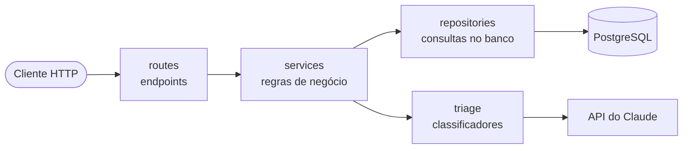
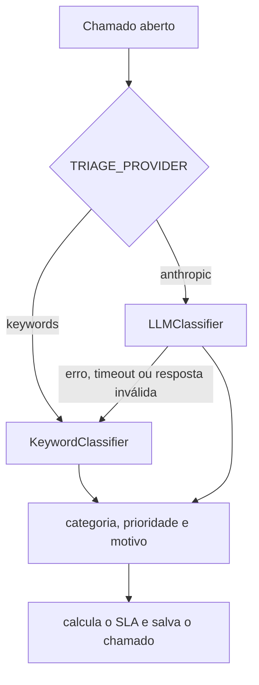

# Ticket Triage API

[](https://github.com/Ricardoleaom/ticket-triage-api/actions/workflows/ci.yml)


API REST para abrir e acompanhar chamados de suporte de TI. Quando alguém abre um chamado, a API faz a **triagem automática**: define a categoria (acesso, rede, hardware...), a prioridade e o prazo de atendimento (SLA). A triagem pode ser feita pelo **Claude** (IA da Anthropic) ou por um classificador de palavras-chave, que também entra em ação quando a IA falha. O chamado nunca deixa de ser aberto por causa da IA.

## Por que este projeto

Trabalhei 15 anos com infraestrutura e vi de perto o que acontece com uma fila de chamados quando tudo chega como "urgente" ou na categoria errada: o atendente perde tempo reclassificando e o que é crítico de verdade fica esperando. Juntei essa experiência com o que venho estudando de backend em Python para construir uma API que organiza a fila sozinha, mas sem depender 100% da IA e medindo se ela está acertando.

## Funcionalidades

- Cadastro e login com JWT
- Três perfis de acesso: solicitante, atendente e administrador
- Triagem automática de categoria e prioridade (Claude ou palavras-chave)
- SLA calculado a partir da prioridade
- Fluxo de status com regras de transição
- Atribuição de responsável e comentários
- Listagem com filtros, paginação e filtro de chamados com SLA vencido
- Relatório com cumprimento de SLA e taxa de correção da triagem
- Documentação interativa com Swagger em `/docs`

## Tecnologias

- **Python 3.12** e **FastAPI**
- **SQLAlchemy 2** (ORM) e **Alembic** (migrações)
- **PostgreSQL** (SQLite para rodar localmente sem Docker)
- **Pydantic** para validação e configuração
- **PyJWT** e **bcrypt** para autenticação
- **Anthropic SDK** para a triagem com o Claude
- **Pytest** e **Ruff**
- **Docker**, **Docker Compose** e **GitHub Actions**

## Arquitetura

O projeto é dividido em camadas. Cada camada só conversa com a de baixo, o que deixa as regras de negócio fáceis de testar e de mudar.



```
app/
├── api/
│   ├── deps.py          # injeção de dependências: sessão, usuário logado e serviços
│   └── routes/          # endpoints: auth, users, tickets e reports
├── core/                # configuração, conexão com o banco, segurança e exceções
├── models/              # tabelas do banco (SQLAlchemy)
├── schemas/             # o que entra e sai da API (Pydantic)
├── repositories/        # acesso ao banco
├── services/            # regras de negócio
├── triage/              # classificadores de chamados
├── cli.py               # comando para criar o primeiro administrador
└── main.py              # cria a aplicação e registra as rotas
alembic/                 # migrações do banco
tests/                   # testes de unidade e de integração
```

Se você vem do Java/Spring, a divisão é parecida: `routes` faz o papel dos controllers, `services` dos services, `repositories` dos repositories, `models` das entidades JPA e `schemas` dos DTOs. O `Depends` do FastAPI faz a injeção de dependências.

### Padrões utilizados

- **Repository**: as consultas ficam isoladas em `repositories/`, os services não escrevem SQL.
- **Service Layer**: as regras de negócio ficam em `services/`, as rotas só recebem a requisição e devolvem a resposta.
- **Strategy**: `Classifier` é uma classe abstrata com duas implementações (`KeywordClassifier` e `LLMClassifier`). O `TicketService` não sabe qual delas está usando.
- **Decorator**: `FallbackClassifier` envolve o classificador principal e chama o reserva quando o principal falha.
- **Factory**: `build_classifier` monta o classificador certo a partir da configuração.
- **Injeção de dependências**: services e classificadores chegam prontos nas rotas, o que permite trocar tudo nos testes.

## Como a triagem funciona



1. O título e a descrição vão para o classificador configurado.
2. Com o Claude, a resposta vem em JSON e é validada contra um schema do Pydantic. Só são aceitas as categorias e prioridades que existem no sistema.
3. Se a API da Anthropic der erro, demorar demais ou responder fora do formato, o `FallbackClassifier` usa as palavras-chave e registra um aviso no log.
4. O chamado guarda quem fez a triagem (`triage_source`) e o motivo (`triage_reason`).
5. Quando um atendente corrige a categoria ou a prioridade, o chamado é marcado com `triage_overridden`. O relatório mostra a taxa de correção, que é a forma de saber se a triagem está acertando.

## Regras de negócio

**Perfis**

| Perfil | O que pode fazer |
| --- | --- |
| `requester` (solicitante) | Abrir chamados, ver e comentar apenas os próprios |
| `agent` (atendente) | Ver todos os chamados, mudar status, corrigir a triagem e atribuir responsável |
| `admin` | Tudo o que o atendente faz e também alterar o perfil dos usuários |

**SLA por prioridade**

| Prioridade | Prazo |
| --- | --- |
| `critical` | 4 horas |
| `high` | 8 horas |
| `medium` | 24 horas |
| `low` | 72 horas |

**Fluxo de status**

| Status atual | Pode mudar para |
| --- | --- |
| `open` | `in_progress`, `closed` |
| `in_progress` | `open`, `resolved` |
| `resolved` | `in_progress` (reaberto), `closed` |
| `closed` | nenhum |

Outras regras:

- Ao mudar para `in_progress` sem responsável, o atendente que fez a mudança assume o chamado.
- Mudar a prioridade recalcula o SLA a partir da data de abertura.
- O responsável precisa ser atendente ou administrador.
- Chamado fechado não pode ser alterado nem receber comentários.
- O administrador não pode alterar o próprio perfil (evita ficar sem nenhum admin por engano).

## Segurança

- Senhas guardadas com bcrypt.
- Token JWT com expiração. Não existe chave padrão: a aplicação não sobe sem `JWT_SECRET_KEY` e exige pelo menos 32 caracteres.
- O login devolve a mesma mensagem para e-mail inexistente e para senha errada, e o tempo de resposta é parecido nos dois casos, para não revelar quais e-mails estão cadastrados.
- Um solicitante que tenta abrir o chamado de outra pessoa recebe 404, e não 403, para não confirmar que aquele id existe.
- O perfil do usuário é lido do banco a cada requisição, então uma mudança de perfil vale na hora.
- O texto do chamado é enviado para a IA como dado: as tags são escapadas e o prompt instrui o modelo a não seguir instruções escritas pelo usuário. Mesmo que alguém tente manipular a IA, a resposta só pode conter valores válidos.
- Os campos têm limite de tamanho, o que também limita o custo de cada chamada à IA.
- O container roda com um usuário sem privilégios e o pipeline de CI tem permissão somente de leitura.

## Como rodar

### Com Docker (recomendado)

```bash
git clone https://github.com/Ricardoleaom/ticket-triage-api.git
cd ticket-triage-api

# cria o .env e gera uma chave aleatória para assinar os tokens
cp .env.example .env
sed -i "s/^JWT_SECRET_KEY=.*/JWT_SECRET_KEY=$(python3 -c 'import secrets; print(secrets.token_urlsafe(32))')/" .env

docker compose up --build
```

A chave JWT não tem valor padrão de propósito: se ela não for definida, nem o Docker Compose nem a aplicação sobem.

A API sobe em `http://localhost:8000` e a documentação fica em `http://localhost:8000/docs`. As migrações rodam automaticamente na inicialização.

Para criar o primeiro administrador:

```bash
docker compose exec api python -m app.cli --name "Admin" --email admin@empresa.com
```

### Sem Docker

```bash
python3 -m venv .venv
source .venv/bin/activate
pip install -r requirements-dev.txt
cp .env.example .env    # e preencha JWT_SECRET_KEY como no passo anterior
alembic upgrade head
python -m app.cli --name "Admin" --email admin@empresa.com
uvicorn app.main:app --reload
```

Nesse modo o banco é um arquivo SQLite (`tickets.db`).

### Usando a triagem com IA

Por padrão a triagem usa palavras-chave e não precisa de nenhuma chave. Para usar o Claude, defina no `.env` (ou nas variáveis de ambiente do Docker Compose):

```env
TRIAGE_PROVIDER=anthropic
ANTHROPIC_API_KEY=sua-chave-da-anthropic
```

O modelo padrão é o `claude-opus-5-5` e pode ser trocado em `ANTHROPIC_MODEL`.

## Endpoints

| Método | Rota | Acesso | Descrição |
| --- | --- | --- | --- |
| GET | `/health` | público | Verifica se a API está no ar |
| POST | `/auth/register` | público | Cria uma conta de solicitante |
| POST | `/auth/login` | público | Retorna o token de acesso |
| GET | `/users/me` | logado | Dados do usuário logado |
| GET | `/users` | admin | Lista os usuários |
| PATCH | `/users/{id}/role` | admin | Altera o perfil de um usuário |
| POST | `/tickets` | logado | Abre um chamado com triagem automática |
| GET | `/tickets` | logado | Lista chamados com filtros e paginação |
| GET | `/tickets/{id}` | logado | Detalhes de um chamado |
| PATCH | `/tickets/{id}` | atendente | Corrige categoria e prioridade ou define o responsável |
| PATCH | `/tickets/{id}/status` | atendente | Muda o status do chamado |
| GET | `/tickets/{id}/comments` | logado | Lista os comentários |
| POST | `/tickets/{id}/comments` | logado | Adiciona um comentário |
| GET | `/reports/summary` | atendente | Indicadores de SLA e da triagem |

Filtros de `GET /tickets`: `status`, `priority`, `category`, `assignee_id`, `overdue`, `limit` e `offset`.

### Exemplo rápido

```bash
# cria a conta
curl -X POST http://localhost:8000/auth/register \
  -H "Content-Type: application/json" \
  -d '{"name": "Maria Silva", "email": "maria@empresa.com", "password": "senha-segura-123"}'

# faz login e copia o access_token da resposta
curl -X POST http://localhost:8000/auth/login \
  -d "username=maria@empresa.com&password=senha-segura-123"

# abre um chamado
curl -X POST http://localhost:8000/tickets \
  -H "Authorization: Bearer SEU_TOKEN" \
  -H "Content-Type: application/json" \
  -d '{"title": "VPN fora do ar", "description": "Ninguém do financeiro consegue conectar na VPN desde cedo"}'
```

Parte da resposta:

```json
{
  "id": 1,
  "title": "VPN fora do ar",
  "category": "network",
  "priority": "critical",
  "status": "open",
  "triage_source": "keywords",
  "triage_reason": "Palavras-chave encontradas: vpn, fora do ar",
  "sla_due_at": "2026-10-30T21:36:01.387008-03:00",
  "created_at": "2026-10-30T17:36:01.387008-03:00"
}
```

## Testes

```bash
pytest
ruff check .
ruff format --check .
```

Os testes cobrem as regras de negócio, as permissões de cada perfil, a autenticação e os classificadores. A chamada ao Claude é testada com respostas simuladas da API, sem gastar créditos.

Localmente os testes usam SQLite em memória. Para rodar no PostgreSQL, defina `TEST_DATABASE_URL`. No GitHub Actions o pipeline:

1. roda o Ruff;
2. aplica as migrações em um PostgreSQL de verdade, confere se elas batem com os models e desfaz tudo;
3. roda os testes no PostgreSQL;
4. faz o build da imagem Docker.

## Decisões técnicas

- **A IA não é obrigatória.** Uma API de chamados não pode parar porque um serviço externo caiu. Por isso a triagem com IA tem timeout curto, uma única nova tentativa e o classificador de palavras-chave como reserva.
- **Medir a IA, e não só usar.** Guardar quem fez a triagem e se o atendente corrigiu permite acompanhar a qualidade com números.
- **Endpoints síncronos.** Como o SQLAlchemy está no modo síncrono, as rotas são `def` comuns e o FastAPI as executa em um pool de threads. Fica mais simples de ler e de depurar.
- **Enums salvos como texto.** Uso `native_enum=False` para não depender do tipo `ENUM` do PostgreSQL, que complica as migrações quando um valor novo aparece.
- **Migrações conferidas no CI.** O `alembic check` falha se alguém alterar um model e esquecer de gerar a migração.

## Próximos passos

- Fazer a triagem em segundo plano (com uma fila) para não segurar a requisição enquanto a IA responde
- Limitar o número de tentativas de login por IP
- Refresh token
- Avisar o atendente quando o SLA estiver perto de vencer
- Histórico de alterações de cada chamado
- Considerar o horário comercial no cálculo do SLA

## Autor

Feito por **Ricardo Leão**.

- GitHub: [@Ricardoleaom](https://github.com/Ricardoleaom)
- Site: [ricardoleao.cloud](https://ricardoleao.cloud)
